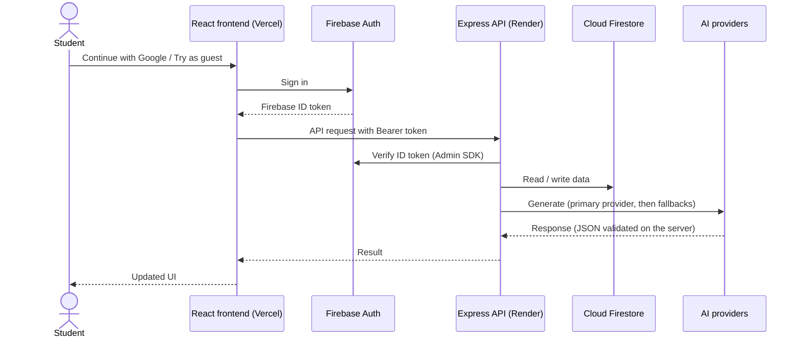

# UniMate: Study Smarter. Connect with Students.

> An AI study companion and peer network for university and college students in Bangladesh and worldwide.

**Built for:** Ostad Presents YUNet AIgnite Buildathon 2026 (solo, B2C web app)
**Author:** Samin Ahmed Chowdhury ([@sam-in07](https://github.com/sam-in07))

| | |
|---|---|
| **Live app** | https://uni-mate-yunet.vercel.app |
| **Backend API** | https://unimate-m2au.onrender.com (health check: `/api/health`) |
| **Repository** | https://github.com/sam-in07/unimate |

> **Note for judges:** the backend runs on a free Render instance that sleeps after about 15 minutes without traffic. The first request after a pause can take 30 to 60 seconds. The app shows a loading state while the server wakes up; please wait a moment and it will respond normally.

---

## Table of contents

1. [The problem](#the-problem)
2. [The solution](#the-solution)
3. [Features](#features)
4. [How the AI is used](#how-the-ai-is-used)
5. [Architecture](#architecture)
6. [Tech stack](#tech-stack)
7. [Project structure](#project-structure)
8. [Getting started locally](#getting-started-locally)
9. [Environment variables](#environment-variables)
10. [Deployment](#deployment)
11. [Privacy, safety and responsible AI](#privacy-safety-and-responsible-ai)
12. [Known limitations](#known-limitations)
13. [Roadmap](#roadmap)
14. [Credits](#credits)

---

## The problem

Students juggle several separate tools to study and to find help:

- Lecture slides and PDFs are long, and turning them into notes and practice questions takes hours.
- Good explanations in **Bangla** or **mixed Banglish** are hard to find in most AI study tools.
- Past question papers are scattered across Facebook groups and chat apps, with no search or tagging.
- Buying used textbooks and finding study partners or research collaborators depends on random posts and personal contacts.

## The solution

UniMate puts two pillars in one product, and connects them.

**Pillar 1: Study.** Upload or paste lecture material and get summaries, active-recall quizzes, a tutor you can ask in Bangla, English or mixed language, an exam planner, a student-contributed past-question library and progress analytics.

**Pillar 2: Student Network.** A used-book marketplace and a collaborator finder with a verified-by-login profile system and in-app chat, so students can trade books and find study partners, conference teammates or paper co-authors without sharing personal contact details publicly.

UniMate is **university-agnostic**: university is a profile field, not hard-coded, so it works for any institution.

## Features

### Study tools

| Feature | What it does |
|---|---|
| **AI Summarizer** | Paste text or upload a PDF; get a structured summary, key points, definitions and revision notes. Supports voice read-aloud. |
| **Active-recall Quiz** | Generates multiple-choice and short-answer questions from your material, with instant feedback and explanations. Attempts are saved. |
| **AI Tutor** | Chat-style tutor for follow-up questions in Bangla, English or mixed language. Supports voice input and read-aloud. |
| **Exam Planner** | Enter exam dates and study time; get a day-by-day study plan. |
| **Past Questions** | Students contribute past question papers (text or PDF) with course, university, year and term. AI tags topics. Browse, search and filter. Clearly marked as student-contributed, never official. |
| **Study Library** | Saved materials, summaries and quizzes in one place. |
| **Study Analytics** | Quiz scores over time and topics that need more practice. |

### Student network

| Feature | What it does |
|---|---|
| **Book Marketplace** | List used books, browse and search, and negotiate through in-app chat. Payment and delivery are arranged by buyer and seller; UniMate does not process payments. |
| **Collaborator Finder** | Find study partners, conference teammates, paper co-authors or project mates by skills, interests, university and availability. |
| **In-app Chat** | Message sellers and accepted connections without exposing phone numbers or email addresses publicly. |
| **Student Profile** | Academic identity, skills, interests, languages and what you are looking for. Report and block tools are available. |

### Accounts

- **Continue with Google** for the full experience (posting, chat, connections).
- **Try as guest** (Firebase anonymous sign-in) to explore the Study tools instantly.

## How the AI is used

AI is the core of the Study pillar and is used to assist the Network pillar.

- **Content generation:** summaries, quizzes, tutoring answers and exam-plan topic breakdowns.
- **Structured output:** quiz and tagging responses are requested as strict JSON, validated on the server, and repaired or rejected if they are malformed.
- **Past-question tagging:** AI proposes topic tags for contributed papers. If a PDF has no readable text, the app does not invent topics.
- **Network assistance:** AI helps with listing and matching tasks.
- **Provider layer:** one AI client talks to a primary provider (Ollama Cloud) and automatically tries configured fallback providers (Groq, Gemini) if the primary fails or is rate-limited. The provider and model names come from environment variables, not from code.
- **Cost and abuse control:** per-user rate limits and response caching protect free-tier quotas.

AI output can contain mistakes. UniMate never claims generated questions are official exam questions or that explanations are official university material. For religious, legal or medical topics, users are encouraged to verify with primary sources and qualified people.

## Architecture

### System overview

The React frontend talks only to the Express API. The API verifies Firebase tokens, reads and writes Cloud Firestore, and calls the AI providers. Secrets live only on the server.

```mermaid
flowchart TB
 subgraph group_study["Study tools"]
        node_summarizer["AI summarizer<br>[SummarizerPage.jsx]"]
        node_quiz["Active-recall quiz<br>[QuizPage.jsx]"]
        node_tutor["AI tutor<br>[TutorPage.jsx]"]
        node_speech["Speech support<br>[speech.js]"]
        node_planner["Exam planner"]
        node_pastq["Past questions"]
        node_library["Study library<br>[LibraryPage.jsx]"]
        node_progress["Study analytics<br>[ProgressPage.jsx]"]
  end
 subgraph group_network["Student network"]
        node_market["Book marketplace"]
        node_partners["Collaborator finder<br>[PartnersPage.jsx]"]
        node_chat["In-app chat<br>[ChatPage.jsx]"]
        node_profile["Student profile<br>[ProfilePage.jsx]"]
  end
 subgraph group_frontend["Frontend foundation"]
        node_app["App routing<br>[App.jsx]"]
        node_authctx["Authentication state<br>[AuthContext.jsx]"]
        node_api["API client<br>[api.js]"]
  end
 subgraph group_backend["Backend services"]
        node_server["API server<br>[server.js]"]
        node_authroute["Auth routes<br>[auth.js]"]
        node_studyroute["Study routes<br>[study.js]"]
        node_networkroute["Network routes<br>[network.js]"]
        node_authmw["Request authentication<br>[auth.js]"]
        node_db["Domain data service<br>[db.js]"]
  end
 subgraph group_data["Data and integrations"]
        node_firebaseweb["Firebase sign-in<br>[firebase.js]"]
        node_aiclient["AI provider client<br>[client.js]"]
        node_firestore[("Cloud Firestore<br>[firebase.js]")]
  end
    node_student(("Student")) -- uses --> node_app
    node_app -- routes to --> node_summarizer & node_quiz & node_tutor & node_planner & node_pastq & node_library & node_progress & node_market & node_partners & node_chat & node_profile
    node_student -- signs in --> node_authctx
    node_authctx -- authenticates with --> node_firebaseweb
    node_authctx -- sets token for --> node_api
    node_summarizer -- requests --> node_api
    node_quiz -- requests --> node_api
    node_tutor -- requests --> node_api
    node_tutor -- uses --> node_speech
    node_summarizer -- uses --> node_speech
    node_planner -- requests --> node_api
    node_pastq -- requests --> node_api
    node_library -- requests --> node_api
    node_market -- requests --> node_api
    node_partners -- requests --> node_api
    node_chat -- requests --> node_api
    node_profile -- requests --> node_api
    node_api -. sends HTTP requests .-> node_server
    node_server -- mounts --> node_authroute & node_studyroute & node_networkroute
    node_authroute -- requires auth --> node_authmw
    node_studyroute -- uses auth --> node_authmw
    node_networkroute -- uses auth --> node_authmw
    node_authroute -- reads and writes --> node_db
    node_studyroute -- uses data service --> node_db
    node_networkroute -- uses data service --> node_db
    node_studyroute -- generates study AI --> node_aiclient
    node_networkroute -- uses AI --> node_aiclient
    node_db -- reads and writes --> node_firestore
    node_aiclient -- calls providers --> node_ai{{"AI providers"}}
    node_authmw -- verifies tokens --> node_firestore

     node_summarizer:::toneBlue
     node_quiz:::toneBlue
     node_tutor:::toneBlue
     node_speech:::toneBlue
     node_planner:::toneBlue
     node_pastq:::toneBlue
     node_library:::toneBlue
     node_progress:::toneBlue
     node_market:::toneAmber
     node_partners:::toneAmber
     node_chat:::toneAmber
     node_profile:::toneAmber
     node_app:::toneMint
     node_authctx:::toneMint
     node_api:::toneMint
     node_server:::toneRose
     node_authroute:::toneRose
     node_studyroute:::toneRose
     node_networkroute:::toneRose
     node_authmw:::toneRose
     node_db:::toneRose
     node_firebaseweb:::toneIndigo
     node_aiclient:::toneIndigo
     node_firestore:::toneIndigo
     node_student:::toneIndigo
     node_ai:::toneIndigo
    classDef toneNeutral fill:#f8fafc,stroke:#334155,stroke-width:1.5px,color:#0f172a
    classDef toneBlue fill:#dbeafe,stroke:#2563eb,stroke-width:1.5px,color:#172554
    classDef toneAmber fill:#fef3c7,stroke:#d97706,stroke-width:1.5px,color:#78350f
    classDef toneMint fill:#dcfce7,stroke:#16a34a,stroke-width:1.5px,color:#14532d
    classDef toneRose fill:#ffe4e6,stroke:#e11d48,stroke-width:1.5px,color:#881337
    classDef toneIndigo fill:#e0e7ff,stroke:#4f46e5,stroke-width:1.5px,color:#312e81
    classDef toneTeal fill:#ccfbf1,stroke:#0f766e,stroke-width:1.5px,color:#134e4a
```



### Request flow



## Tech stack

| Layer | Technology |
|---|---|
| Frontend | React, Vite, Tailwind CSS, React Router, Framer Motion |
| Backend | Node.js, Express |
| Auth | Firebase Authentication (Google and Anonymous), token verification with Firebase Admin SDK |
| Database | Cloud Firestore |
| AI | Ollama Cloud (primary), Groq and Google Gemini (fallbacks), all configurable by environment variables |
| Voice | Browser Web Speech API (speech input and read-aloud) |
| Hosting | Vercel (frontend), Render (backend) |

## Project structure

```
.
├── backend/
│   ├── src/
│   │   ├── ai/                # AI provider client (primary + fallbacks, JSON validation)
│   │   ├── config/            # Firebase Admin setup and config
│   │   ├── middleware/        # Request authentication
│   │   ├── routes/            # auth, health, network, study
│   │   ├── schemas/           # Request validation schemas
│   │   ├── seed/              # Demo seed data script
│   │   ├── services/          # Firestore data service
│   │   └── server.js          # Express app entry point
│   ├── test/                  # Backend test suites
│   └── package.json
├── frontend/
│   ├── public/                # Buildathon sticker, favicon
│   ├── src/
│   │   ├── components/        # Navbar, Sidebar, AuthModal, CommandPalette, UserAvatar
│   │   ├── context/           # Auth, theme and toast providers
│   │   ├── lib/               # API client, Firebase web SDK, speech helpers
│   │   ├── pages/             # One file per page (Summarizer, Quiz, Tutor, Marketplace...)
│   │   ├── App.jsx
│   │   └── main.jsx
│   └── package.json
├── firestore.rules            # Firestore security rules
└── README.md
```

## Getting started locally

### Prerequisites

- Node.js 18 or newer and npm
- A Firebase project with **Authentication** (Google and Anonymous providers enabled) and **Cloud Firestore**
- A Firebase **service account** key (JSON) for the backend
- An API key for at least one AI provider (Ollama Cloud, Groq or Gemini)

### 1. Clone

```bash
git clone https://github.com/sam-in07/unimate.git
cd unimate
```

### 2. Backend

```bash
cd backend
npm install
# create backend/.env (see the variable names below)
npm run dev        # starts the API on http://localhost:8080
```

Place your Firebase service account JSON at `backend/firebase-service-account.json` (it is git-ignored) and point `FIREBASE_SERVICE_ACCOUNT_PATH` to it.

Check the server and AI providers:

- `http://localhost:8080/api/health`
- `http://localhost:8080/api/health/ai`

### 3. Frontend

```bash
cd frontend
npm install
# create frontend/.env (see the variable names below)
npm run dev        # starts the app on http://localhost:5173
```

### 4. Optional: demo data

```bash
cd backend
node src/seed/seed.js
```

Seed entries are fictional and labelled as demo data.

> Restart the backend and the frontend after you change a `.env` file. They read it only at startup.

## Environment variables

Only variable **names** are listed here. Never commit real values.

### Backend (`backend/.env`)

| Variable | Purpose |
|---|---|
| `PORT` | Server port (local default 8080; set automatically on Render) |
| `FRONTEND_ORIGIN` | Allowed frontend origin for CORS, exact URL with no trailing slash |
| `FIREBASE_SERVICE_ACCOUNT_PATH` | Path to the Firebase service account JSON file |
| `FIREBASE_SERVICE_ACCOUNT_JSON` | Alternative: the service account JSON as a single-line string (used on hosts without file upload) |
| `AI_PRIMARY` | Primary provider (`ollama`) |
| `AI_FALLBACKS` | Comma-separated fallback providers (for example `groq,gemini`) |
| `OLLAMA_BASE_URL` | Ollama Cloud base URL |
| `OLLAMA_API_KEY` | Ollama Cloud API key |
| `OLLAMA_MODEL` | Model name for Ollama Cloud |
| `GROQ_API_KEY`, `GROQ_BASE_URL`, `GROQ_MODEL` | Groq fallback settings |
| `GEMINI_API_KEY`, `GEMINI_MODEL` | Gemini fallback settings |

A provider with no key is treated as "not configured". The app works with a single configured provider.

### Frontend (`frontend/.env`)

| Variable | Purpose |
|---|---|
| `VITE_API_BASE_URL` | Backend API base URL, ending in `/api` |
| `VITE_FIREBASE_API_KEY` | Firebase web config |
| `VITE_FIREBASE_AUTH_DOMAIN` | Firebase web config |
| `VITE_FIREBASE_PROJECT_ID` | Firebase web config |
| `VITE_FIREBASE_APP_ID` | Firebase web config |

Variables that start with `VITE_` are visible in the browser. Put only public configuration in them, never secrets.

## Deployment

### Frontend: Vercel

1. Import the GitHub repository and set the **Root Directory** to `frontend`.
2. Add the `VITE_*` variables above for the **Production** environment.
3. Deploy. If you change an environment variable later, **redeploy without the build cache**, because Vite embeds variables at build time.

### Backend: Render

1. Create a **Web Service** from the repository with **Root Directory** `backend`.
2. Build command `npm install`, start command `npm start`.
3. Add the backend environment variables. Use `FIREBASE_SERVICE_ACCOUNT_JSON` for the service account.
4. Set `FRONTEND_ORIGIN` to the deployed frontend URL.

### Firebase

- Add the deployed frontend domain to **Authentication → Settings → Authorized domains**. Without this, Google sign-in fails on the live site.
- Paste `firestore.rules` into **Firestore → Rules** and publish.
- If Firestore asks for a composite index, the backend logs the creation link.

## Privacy, safety and responsible AI

- **No public phone numbers or email addresses.** Students communicate through in-app chat.
- **Open to students of all levels,** including high school and college students, so networking is request-based with **report** and **block** tools.
- **Secrets stay on the server.** The browser never receives AI keys or the Firebase service account. The user ID comes from a verified Firebase token, never from the request body.
- **Authorization on the backend,** not only in the UI: posting, chatting and connecting need a Google account; guests are limited.
- **Honest AI.** No canned answers are presented as live AI output. Failures show a clear error or fall back to another provider.
- **Student-contributed content** (past questions, listings) is labelled and can be reported.
- **Demo data** is fictional and labelled.

## Known limitations

- **Free-tier hosting:** the Render backend sleeps when idle, so the first request can be slow.
- **File storage:** uploaded files (for example past-question PDFs) are stored on the backend's local disk, which is cleared when a free Render instance restarts or redeploys. Moving files to external storage is planned.
- **Scanned PDFs:** if a PDF has no readable text layer, text extraction may be empty and the app will not invent questions or topics.
- **AI limits:** free-tier AI quotas can be reached under heavy use. Fallback providers reduce, but do not remove, this risk.
- **Voice:** speech input and read-aloud use the browser's Web Speech API, so quality and language support depend on the browser and device. Bangla support varies.
- **Student verification:** accounts use Google sign-in only. University or student-ID verification is not implemented yet.
- **No payments:** the marketplace is a listing and chat service only.

## Roadmap

- Move file uploads to durable external storage.
- University-email or student-ID verification badge.
- Wellbeing tools: private check-ins, study-balance support and a safety net that points to local helplines.
- Accessibility panel: font size, high contrast and a dyslexia-friendly font.
- Better Bangla speech recognition and read-aloud.
- Launch with a few universities first, then expand to a wider student network.

## Credits

- Organised by **Youth Upskill Network (YUNet)** and **Ostad** for the AIgnite Buildathon 2026.
- Built with React, Vite, Tailwind CSS, Express, Firebase, Ollama Cloud, Groq and Google Gemini, hosted on Vercel and Render.
- Icons and fonts from their respective open-source projects (lucide-react, Inter, Hind Siliguri).
- Built with the help of AI coding assistants. All features were tested by the author before submission.
